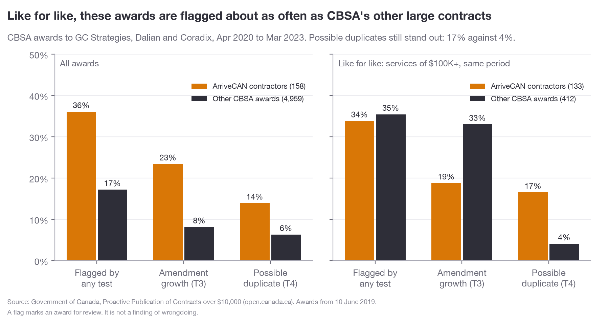
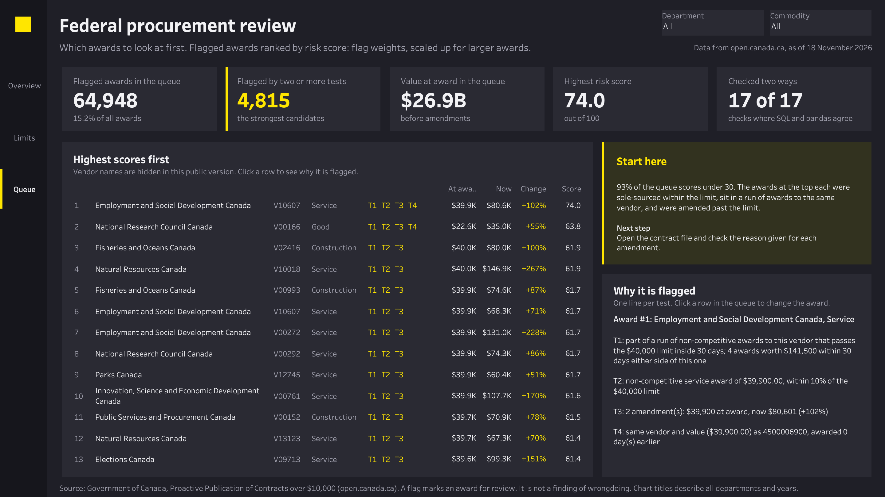

# Canadian federal procurement | Which contracts to review first

**Author:** Neo Nguyen · **Stack:** PostgreSQL · Python (pandas, rapidfuzz, matplotlib) · Tableau

A federal department may award a service contract of up to $40,000 without asking for bids. In the last $5,000 up to that limit there are 18,990 awards where the values below it predict about 9,900.

This project loads the government's [published contract data](https://open.canada.ca/data/en/dataset/d8f85d91-7dec-4fd1-8055-483b77225d8b) into PostgreSQL, runs five audit tests based on the [Government Contracts Regulations](https://laws-lois.justice.gc.ca/eng/regulations/SOR-87-402/section-6.html) over seven years of awards, and ranks the awards they flag, so that a review team with limited time knows which files to open first.

**[Read the full report with charts](reports/report.md)**


## Questions

1. Which contract awards match a pattern worth a reviewer's time, and in what order should they be read?
2. Do awards pile up just under the dollar limit that requires bids, beyond what round-number pricing would explain?
3. Would the tests have pointed at contracts that an audit later examined?

## Results

| Finding | Value |
|---|---|
| Awards analysed | 427,302 awards, 95 departments, 10 June 2019 to October 2026 |
| Value | $156.1B at award, $192.3B after amendments |
| Non-competitive share | 36.6% of awards; 34.2% in 2019-20 (from June), 39.1% in 2024-25 |
| Flagged by at least one test | 64,948 awards (15.2%); 4,815 by two or more |
| Service awards in the last $5,000 up to $40,000 | 1.92 times the trend (95% interval 1.84 to 1.99) |
| Same, non-competitive awards only | 2.63 times; competitive awards 1.25 times |
| Same calculation at $60K to $90K, where no rule changes | 0.89 to 1.21 times |
| Non-competitive share just under and just over the limit | 66.8% under, 31.7% over |
| Sole-sourced within the limit, then amended past it | 2,071 awards: $55.3M at award, $165.7M now |
| Non-competitive awards with no s.6 exception recorded | 37% to 42% a year since 2022-23 (the field is optional) |
| ArriveCAN contractors at CBSA, share of awards flagged | 36% against 17% for all other CBSA awards; like for like (services of $100K+), 34% against 35%; possible duplicates 17% against 4% |

**The five tests**

| Test | Flags | Awards | Value at award |
|---|---|---|---|
| T1 Contract splitting | Non-competitive awards to one vendor within 30 days, each within the limit, together over it | 13,424 | $289.6M |
| T2 Sole-source near the limit | Non-competitive award in the top 10% of the range that needs no bids | 20,231 | $682.9M |
| T3 Amendment growth | Value now more than 50% above the award, or three or more amendments | 26,659 | $25.1B |
| T4 Possible duplicate | Same department, vendor and value within 7 days | 9,597 | $1.0B |
| T5 Vendor concentration | One vendor with over half of a department's non-competitive spending | 19 | $302.3M |

Every test is written twice, in SQL and in pandas, and a script compares the two award by award. They agree on all 17 comparisons. A flag marks an award for review. It is not a finding that anything was done wrong, and most flagged awards will have an ordinary explanation.

The excess under the goods limit of $25,000 (1.40 times the trend) is real but reads differently: competitive goods awards show nearly the same excess as non-competitive ones, so the bid requirement cannot be the whole explanation (report section 5).

## Charts

| | |
|---|---|
|  |  |
| The share of awards made without competition, by contract value | The excess at the real limits against four round values where no rule changes |
|  |  |
| Value at award against value now, for every amended contract | Flag rates for the ArriveCAN contractors' awards, against all CBSA awards and like for like |

All 12 charts are in the [full report](reports/report.md).

## Dashboard

A three-page Tableau dashboard on the same run: an overview, the pile-up under the $40,000 limit, and the review queue, where a click on an award shows why it was flagged. [`tableau/procurement_review.twb`](tableau/procurement_review.twb) opens in Tableau Desktop or Tableau Public once the pipeline has written the data files. The pipeline writes the workbook too, so the figures in its text follow the data; [`tableau/README.md`](tableau/README.md) covers opening, publishing and how it is built.


| | |
|---|---|
|  |  |
| Awards per $1,000 against the trend, and each department against its own range | The highest-scoring awards, with the reasons for the selected one |

## Data and sources

| Source | Used for |
|---|---|
| [Proactive Publication: Contracts over $10,000](https://open.canada.ca/data/en/dataset/d8f85d91-7dec-4fd1-8055-483b77225d8b), Government of Canada | The contract data: one CSV of 1,336,111 rows and 43 columns, last modified on the portal on 18 November 2026 |
| [Data dictionary](https://open.canada.ca/data/recombinant-published-schema/contracts.json) for that file | Column definitions and code lists; the pipeline checks the CSV header against it |
| [Contract search](https://search.open.canada.ca/contracts/) on open.canada.ca | Looking up a single contract by hand |
| [Government Contracts Regulations, section 6](https://laws-lois.justice.gc.ca/eng/regulations/SOR-87-402/section-6.html) | The $25,000 and $40,000 limits, in force since 10 June 2019 |
| Auditor General of Canada, [2024 Report 1: ArriveCAN](https://www.oag-bvg.gc.ca/internet/English/att__e_44429.html) ([PDF](https://open.canada.ca/data/en/info/2a492f50-15c0-4ced-91b9-3260e85e1f7a)) | The case study in report section 10 |
| CBSA, [briefing to the Public Accounts committee on ArriveCAN](https://www.cbsa-asfc.gc.ca/transparency-transparence/pd-dp/bbp-rpp/pacp/2024-05-14/overview-apercu-eng.html) | Which firms the case study includes |

Each run records the portal's last-modified stamp, the file size and the row count, and checks the CSV header against the data dictionary before anything else runs. The 655 MB file is not in this repository; the pipeline downloads it.

## Run the pipeline

The script is for macOS or Linux. You need Python 3 (tested on 3.15) and PostgreSQL 14 or later running on `localhost:5432`. On a Mac the simplest way to get PostgreSQL is [Postgres.app](https://postgresapp.com). The pipeline creates the `procurement_audit` database and a `procurement` schema by itself. To use another server, set `PROCUREMENT_PG_DSN`, for example `host=localhost dbname=procurement_audit user=me password=...`.

```bash
./run_pipeline.sh
```

The script creates `.venv` on first run and installs the libraries listed at its top (pandas, pyarrow, psycopg, requests, rapidfuzz, matplotlib, pytest). Then it downloads the data and checks its header, cleans it and merges vendor spellings, rebuilds the PostgreSQL schema with the five tests, the risk score and 18 blocking checks in one transaction, reconciles SQL against pandas, runs the bunching, sensitivity and case-study analyses, writes every reported number to `data/processed/results.json`, brings the numbers in this README and the report up to date, redraws the charts, writes the Tableau workbook and the files it reads, and runs the unit tests. A full run takes under two minutes once the file is downloaded.

The portal replaces the file most days, so each run fetches the newest one in place of the last. `src/update_docs.py` then compares the new results with the previous run's and rewrites each figure that moved, along with the data date. A figure it cannot place with certainty is named in the output, and the document test fails until it is fixed.

## Project layout

```
src/
  config.py        every setting and every source link: dates, dollar limits, test cut-offs, score weights
  fetch_data.py    download the CSV and data dictionary, check the header, record the vintage
  clean.py         parse and clean the raw file, count everything changed or dropped
  vendors.py       vendor names: rule-based clean-up, fuzzy merge, review sample
  db.py            PostgreSQL connection, CSV loading, query helper
  run_sql.py       builds the schema, loads the data, runs the checks
  flags.py         the five tests and the risk score a second time, in pandas
  reconcile.py     SQL against pandas, award by award
  bunching.py      awards under the limit against the trend, with placebo values
  sensitivity.py   flag counts as each cut-off moves
  case_study.py    the ArriveCAN contractors against two baselines
  results.py       every number the report quotes, in one JSON file
  update_docs.py   moves the figures in README.md and report.md on to the latest run
  charts.py        report figures
  export_tableau.py  the files the Tableau dashboard reads, with no vendor names
sql/
  01_tables.sql       schema, code lists, keys and indexes
  02_views.sql        contracts (award plus amendments) and the awards analysed
  03_audit_tests.sql  the five tests, the flags table and the risk score
  04_checks.sql       18 blocking checks and 16 descriptive ones
  05_tableau_views.sql  one row per award, as the dashboard shows it
tableau/           the dashboard workbook, the script that writes it, screenshots and a short guide (README.md)
tests/             cleaning, vendor matching, contract assembly (on a test database), the five tests, bunching,
                   case study, settings, the Tableau files and workbook, documents and their updates
data/raw/          the portal file (downloaded, not committed) and its data dictionary
data/processed/    analysis outputs and results.json; the large cleaned tables are rebuilt, not committed
data/tableau/      files for the dashboard; awards.csv (77 MB) is rebuilt, not committed
reports/           report.md and figures/
```

## Key assumptions

- The limits are $25,000 for goods and $40,000 for everything else, from section 6(b) of the Government Contracts Regulations as it has read since 10 June 2019. "Does not exceed" means an award of exactly $40,000 is within the limit.
- The analysis starts on 10 June 2019 because the $40,000 limit did not exist before it. Awards from April 2017 are loaded so amendments can find them, and are not tested.
- The regulation allows $100,000 for some architectural, engineering and international development contracts. The data cannot identify them, so they are tested against $40,000.
- A contract is everything reported under one department and procurement number. The earliest award row is the award. The current value comes from that row or its latest amendment; when the latest quarter holds several, an amendment beats the award row and the higher total wins.
- An advance contract award notice counts as non-competitive, because no bids are received.
- Call-ups against standing offers are left out of the splitting test.
- Vendor spellings are merged by rule and then by fuzzy matching at 94 out of 100. In a hand check of 100 merged names, 95 were the same supplier.
- Contracts of $10,000 or less are not published in this file and cannot be seen.

## Licence

The code is under the [MIT licence](LICENSE). Contains information licensed under the [Open Government Licence, Canada](https://open.canada.ca/en/open-government-licence-canada).
