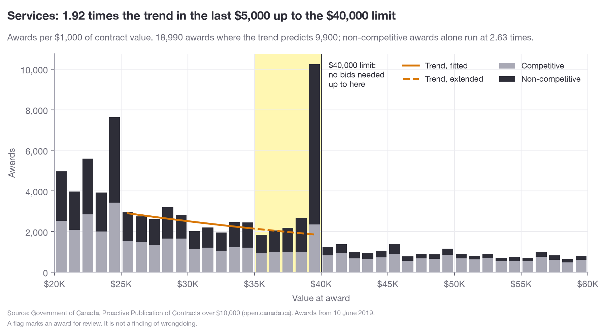
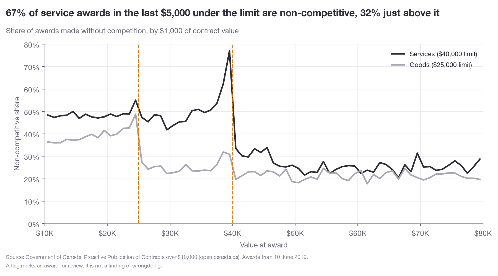
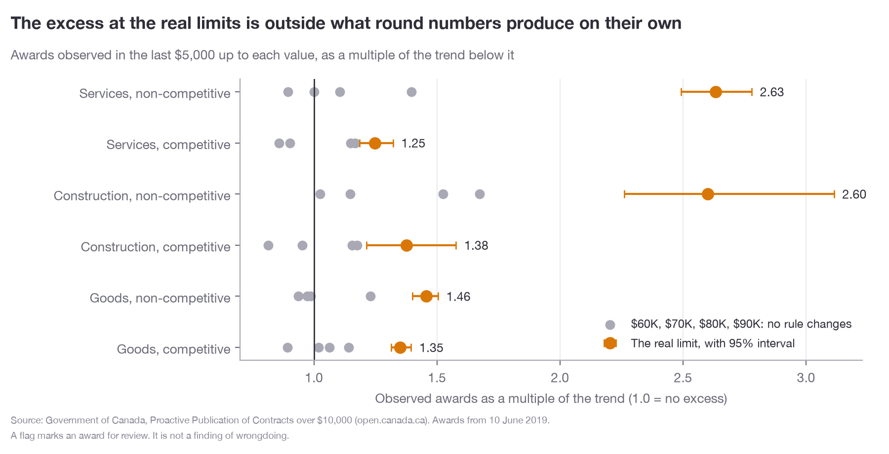
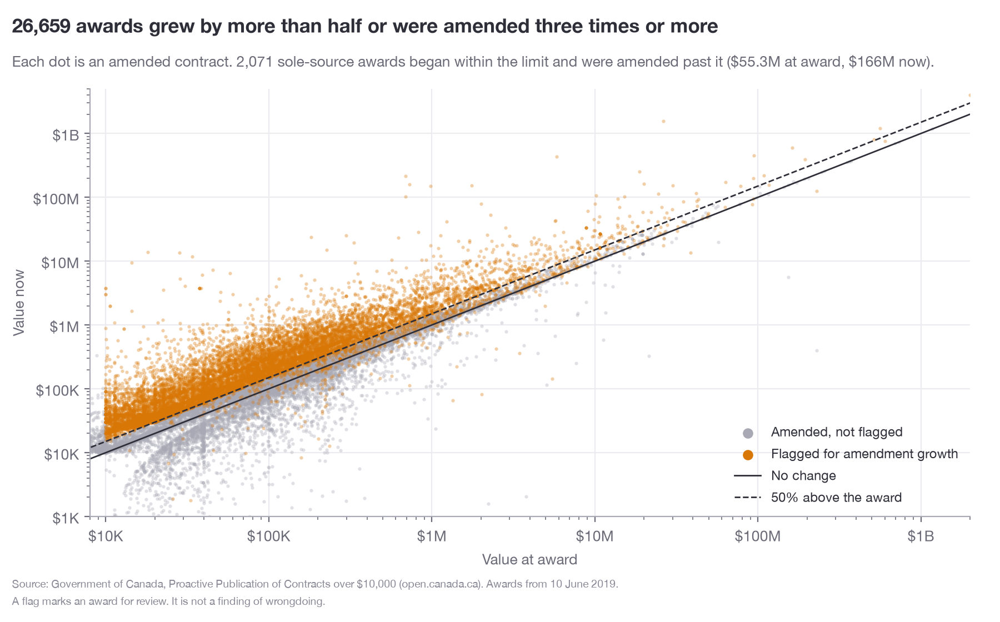
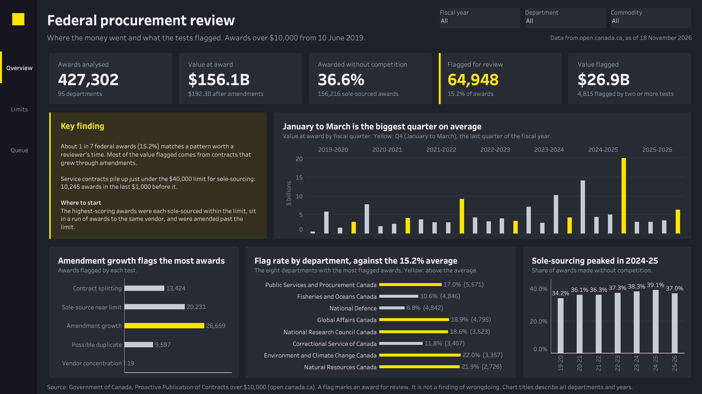
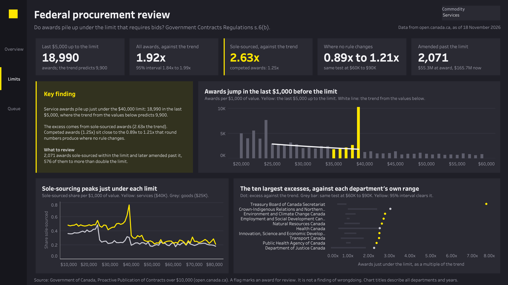

# Canadian federal procurement | Which contracts to review first

**Author:** Neo Nguyen · **Stack:** PostgreSQL · Python (pandas, rapidfuzz, matplotlib) · Tableau

Canadian federal departments can give a service contract worth up to $40,000 to the supplier of their choice without asking anyone else to bid. One dollar more and the work has to be competed. Count the contracts at each value and that line is easy to find:



In the last $5,000 before $40,000 there are 18,990 service awards, about twice the 9,900 that the values below would predict, and two thirds of them were sole-sourced. Further up, at round numbers where no rule changes, the same count finds no pile-up of that size.

## What this project does

The government publishes every contract over $10,000, about 60,000 a year, and no audit team can read them all. This project loads seven years of them into PostgreSQL, runs five checks for patterns an auditor would want to see (one purchase split into several small contracts, a sole-source award priced just under the limit, a contract that keeps growing after it is signed), scores what they flag, and puts the awards in the order a reviewer should open them.

What it found:

- Service contracts pile up just under the $40,000 limit, and the extra ones are mostly sole-sourced: 2.63x the trend for sole-sourced awards, against 1.25x for competed ones.
- 2,071 awards were sole-sourced within the limit and later amended past it. They were worth $55.3M when signed and are worth $165.7M now.
- 64,948 awards (15.2%) are flagged. The ones at the top of the queue look alike: sole-sourced just under the limit, part of a run of awards to the same vendor, then amended well past it.
- Run against ArriveCAN, whose contracts the Auditor General later examined, the checks did not single out its contractors overall, but they flagged their same-value contracts issued days apart four times as often.

The [full report](reports/report.md) has the method, the limits of the analysis and all 12 charts. The [Tableau dashboard](tableau/README.md) lets you filter by year, department and type of purchase, and click an award to see why it was flagged.

## Questions

1. Which awards should a reviewer read first?
2. Do awards pile up just under the limit that requires bids, more than round-number pricing would explain?
3. Would these checks have pointed at the ArriveCAN contracts the Auditor General later examined?

## Results

| Measure | Result |
|---|---|
| Awards analysed | 427,302 from 95 departments, 10 June 2019 to October 2026 |
| Their value | $156.1B when signed, $192.3B after amendments |
| Given without competition | 36.6% of awards, up from 34.2% in 2019-20 (from June) to 39.1% in 2024-25 |
| Flagged for review | 64,948 awards (15.2%), 4,815 of them by two or more checks |
| Service awards in the last $5,000 before $40,000 | about twice the trend: 1.92x (95% interval 1.84x to 1.99x) |
| The same, sole-sourced awards only | 2.63x the trend; competed awards 1.25x |
| The same test at $60K to $90K, where no rule applies | 0.89x to 1.21x, which is what round numbers alone produce |
| Sole-sourced share just under and just over $40,000 | 66.8% under, 31.7% over |
| Signed within the limit, then amended past it | 2,071 awards: $55.3M when signed, $165.7M now |
| No reason recorded for skipping competition | 37% to 42% of sole-sourced awards a year since 2022-23 (the field is optional) |
| ArriveCAN contractors at CBSA, share flagged | 36% against 17% for CBSA's other awards; against similar contracts (services of $100K+), 34% against 35%; for same-value contracts issued days apart, 17% against 4% |

**The five checks**

| Check | What it looks for | Awards | Value when signed |
|---|---|---|---|
| T1 Contract splitting | Several sole-source awards to one vendor within 30 days, each under the limit but over it together | 13,424 | $289.6M |
| T2 Sole-source near the limit | A sole-source award in the top 10% below the limit ($36,000 to $40,000 for services) | 20,231 | $682.9M |
| T3 Amendment growth | Worth more than 50% above the signed value now, or amended three or more times | 26,659 | $25.1B |
| T4 Possible duplicate | Same department, vendor and amount within 7 days | 9,597 | $1.0B |
| T5 Vendor concentration | One vendor holding over half of a department's sole-source spending | 19 | $302.3M |

Each check is written twice, once in SQL and once in pandas, and a script compares the two award by award; they agree on all 17 comparisons. A flag means a file is worth opening. Most flagged awards will have an ordinary explanation, and nothing here is a finding that anything was done wrong.

Goods have a lower limit, $25,000, and a smaller pile-up under it (1.40x the trend). Competed goods awards pile up almost as much as sole-sourced ones there, though, so the bidding rule cannot be the whole reason (report section 5).

## Charts

| | |
|---|---|
|  |  |
| Share of awards given without competition, by contract value | The pile-up at the real limits, against four round values where no rule applies |
|  |  |
| Value when signed against value now, for every amended contract | How often the ArriveCAN contractors' awards were flagged, against CBSA's other awards and similar contracts |

All 12 charts are in the [full report](reports/report.md).

## Dashboard

A three-page Tableau dashboard on the same run: an overview, the pile-up under the $40,000 limit, and the review queue, where a click on an award shows why it was flagged. [`tableau/procurement_review.twb`](tableau/procurement_review.twb) opens in Tableau Desktop or Tableau Public once the pipeline has written the data files. The pipeline writes the workbook too, so the figures in its text follow the data; [`tableau/README.md`](tableau/README.md) covers opening, publishing and how it is built.



| | |
|---|---|
|  |  |
| Awards per $1,000 against the trend, and each department against its own range | The highest-scoring awards, with the reasons for the selected one |

## Data and sources

| Source | Used for |
|---|---|
| [Proactive Publication: Contracts over $10,000](https://open.canada.ca/data/en/dataset/d8f85d91-7dec-4fd1-8055-483b77225d8b), Government of Canada | The contract data: one CSV of 1,336,111 rows and 43 columns, last modified on the portal on 18 November 2026 |
| [Data dictionary](https://open.canada.ca/data/recombinant-published-schema/contracts.json) for that file | Column definitions and code lists; the pipeline checks the CSV header against it |
| [Contract search](https://search.open.canada.ca/contracts/) on open.canada.ca | Looking up a single contract by hand |
| [Government Contracts Regulations, section 6](https://laws-lois.justice.gc.ca/eng/regulations/SOR-87-402/section-6.html) | The $25,000 and $40,000 limits, in force since 10 June 2019 |
| Auditor General of Canada, [2024 Report 1: ArriveCAN](https://www.oag-bvg.gc.ca/internet/English/att__e_44429.html) ([PDF](https://open.canada.ca/data/en/info/2a492f50-15c0-4ced-91b9-3260e85e1f7a)) | The case study in report section 10 |
| CBSA, [briefing to the Public Accounts committee on ArriveCAN](https://www.cbsa-asfc.gc.ca/transparency-transparence/pd-dp/bbp-rpp/pacp/2024-05-14/overview-apercu-eng.html) | Which firms the case study includes |

Each run records the portal's last-modified stamp, the file size and the row count, and checks the CSV header against the data dictionary before anything else runs. The 655 MB file is not in this repository; the pipeline downloads it.

## Run the pipeline

You need macOS or Linux, Python 3 and PostgreSQL 14 or later on `localhost:5432` ([Postgres.app](https://postgresapp.com) on a Mac). For another server, set `PROCUREMENT_PG_DSN`. The first run installs its libraries into `.venv`.

```bash
./run_pipeline.sh
```

One command rebuilds everything, in under two minutes once the file is downloaded:

1. Downloads the newest file from the portal and checks its header.
2. Cleans it and merges vendor spellings.
3. Builds the database, the five tests and the risk score, behind 18 blocking checks.
4. Checks SQL against pandas, then runs the bunching, sensitivity and case-study analyses.
5. Updates every figure in this README and the report, redraws the charts and rebuilds the Tableau workbook.
6. Runs the unit tests.

## Project layout

```
src/
  config.py        every setting and every source link: dates, dollar limits, test cut-offs, score weights
  fetch_data.py    download the CSV and data dictionary, check the header, record the vintage
  clean.py         parse and clean the raw file, count everything changed or dropped
  vendors.py       vendor names: rule-based clean-up, fuzzy merge, review sample
  db.py            PostgreSQL connection, CSV loading, query helper
  run_sql.py       builds the schema, loads the data, runs the checks
  flags.py         the five tests and the risk score a second time, in pandas
  reconcile.py     SQL against pandas, award by award
  bunching.py      awards under the limit against the trend, with placebo values
  sensitivity.py   flag counts as each cut-off moves
  case_study.py    the ArriveCAN contractors against two baselines
  results.py       every number the report quotes, in one JSON file
  update_docs.py   moves the figures in README.md and report.md on to the latest run
  charts.py        report figures
  export_tableau.py  the files the Tableau dashboard reads, with no vendor names
sql/
  01_tables.sql       schema, code lists, keys and indexes
  02_views.sql        contracts (award plus amendments) and the awards analysed
  03_audit_tests.sql  the five tests, the flags table and the risk score
  04_checks.sql       18 blocking checks and 16 descriptive ones
  05_tableau_views.sql  one row per award, as the dashboard shows it
tableau/           the dashboard workbook, the script that writes it, screenshots and a short guide (README.md)
tests/             cleaning, vendor matching, contract assembly (on a test database), the five tests, bunching,
                   case study, settings, the Tableau files and workbook, documents and their updates
data/raw/          the portal file (downloaded, not committed) and its data dictionary
data/processed/    analysis outputs and results.json; the large cleaned tables are rebuilt, not committed
data/tableau/      files for the dashboard; awards.csv (77 MB) is rebuilt, not committed
reports/           report.md and figures/
```

## Key assumptions

- The limits are $25,000 for goods and $40,000 for everything else, from section 6(b) of the Government Contracts Regulations as it has read since 10 June 2019. "Does not exceed" means an award of exactly $40,000 is within the limit.
- The analysis starts on 10 June 2019 because the $40,000 limit did not exist before it. Awards from April 2017 are loaded so amendments can find them, and are not tested.
- The regulation allows $100,000 for some architectural, engineering and international development contracts. The data cannot identify them, so they are tested against $40,000.
- A contract is everything reported under one department and procurement number. The earliest award row is the award. The current value comes from that row or its latest amendment; when the latest quarter holds several, an amendment beats the award row and the higher total wins.
- An advance contract award notice counts as non-competitive, because no bids are received.
- Call-ups against standing offers are left out of the splitting test.
- Vendor spellings are merged by rule and then by fuzzy matching at 94 out of 100. In a hand check of 100 merged names, 95 were the same supplier.
- Contracts of $10,000 or less are not published in this file and cannot be seen.

## Licence

The code is under the [MIT licence](LICENSE). Contains information licensed under the [Open Government Licence, Canada](https://open.canada.ca/en/open-government-licence-canada).
