# Canadian federal procurement: which contracts to review first

**Author:** Neo Nguyen · **Data as of:** 17 November 2026 (portal file last modified and downloaded that day) · **Tools:** PostgreSQL, Python, matplotlib

## Summary

An internal audit team can read a few dozen contract files a week. The federal government publishes about 60,000 contract awards over $10,000 every year. This report asks which of them a reviewer should open first, and why.

I loaded the government's own [published contract data](https://open.canada.ca/data/en/dataset/d8f85d91-7dec-4fd1-8055-483b77225d8b) into PostgreSQL, joined each award to its amendments, and ran five tests based on the [Government Contracts Regulations](https://laws-lois.justice.gc.ca/eng/regulations/SOR-87-402/section-6.html). The analysis starts on 10 June 2019, the day the current dollar limits came into force, and runs to October 2026. That is 427,302 awards from 95 departments, worth $156.1 billion at award and $192.3 billion after amendments. The tests flag 64,948 of them (15.2%) for review, and 4,815 are flagged by two or more tests.

Service contracts pile up just under $40,000, the value up to which a department may skip soliciting bids. In the last $5,000 up to the limit there are 18,990 awards where the trend of the values below predicts 9,900, which is 1.92 times as many. For non-competitive awards alone the figure is 2.63 times, and for competitive awards 1.25 times. The same calculation at $60,000, $70,000, $80,000 and $90,000, where no rule changes, gives between 0.89 and 1.21 times. Two thirds of service awards in that last $5,000 are non-competitive (66.8%), against 31.7% in the $5,000 above it.

2,071 awards were made without competition at a value within the limit and then amended past it. They were worth $55.3 million at award and are worth $165.7 million now. In 576 of them the current value is more than double the limit.

I also checked the tests against contracts an audit later examined: the Canada Border Services Agency's 158 awards to the firms named in the Auditor General's [2024 ArriveCAN report](https://www.oag-bvg.gc.ca/internet/English/att__e_44429.html). Against all of the agency's other awards they are flagged twice as often (36% against 17%). Against its other service contracts of the same size and period they are flagged about as often (34% against 35%). One test still sets them apart: identical-value contracts issued close together, 17% against 4%.

A flag is a reason to open a file. It says a contract matches a pattern worth a second look, and most flagged contracts will have an ordinary explanation. Nothing in this report is a finding that any contract or supplier did something wrong.

## Key terms

| Term | What it means here |
|---|---|
| Award | The contract as first signed. One row of type C in the published data. |
| Amendment | A later change to a contract's value or dates. Each one is published as its own row of type A, pointing back to the award. |
| Contract | An award together with all of its amendments. |
| Value at award, value now | What the contract was worth when signed, and what it is worth after every amendment published so far. |
| Competitive | Bids were solicited: open bidding, traditional competition, or selective tendering. |
| Non-competitive (sole-source) | The contract went to one supplier without soliciting bids. I count advance contract award notices here too, since no bids are received. |
| The limit, or s.6(b) limit | [Section 6(b)](https://laws-lois.justice.gc.ca/eng/regulations/SOR-87-402/section-6.html) of the Government Contracts Regulations lets a department skip soliciting bids when the contract "does not exceed" $25,000 for goods or $40,000 for other contracts. A contract of exactly $40,000 is still within the limit. |
| Standing offer | A pre-arranged deal with set prices. Departments place small orders ("call-ups") against it without a new competition, because the competition was held when the offer was set up. |
| Fiscal year | April to March. Fiscal 2024-25 ends on 31 March 2025. |
| Flag | A test's signal that an award matches a pattern worth reviewing. |
| Contract splitting | Buying one requirement as several smaller contracts, each within the limit. |
| Bunching | More awards just under a threshold than the surrounding values would lead you to expect. |
| Trend | A smooth curve fitted to the number of awards at values below the limit, used to say how many awards "should" be just under it. |
| Placebo | Running the same calculation where nothing should happen, to see how much of a result the method produces by itself. |
| 95% interval | The range the estimate stays in for 95 of 100 resamples of the data. It measures sampling noise only; the placebos show how far the method itself can stray. |
| Risk score | A 0 to 100 number that ranks flagged awards for review. More flags and a larger contract both raise it. |
| Reconciliation | Computing the same result two independent ways and checking they match. |

## 1. Data

The source is the Government of Canada's [Proactive Publication of Contracts over $10,000](https://open.canada.ca/data/en/dataset/d8f85d91-7dec-4fd1-8055-483b77225d8b) on open.canada.ca. Every department reports each quarter, and the portal publishes one CSV for all of them. Any single contract can be looked up by hand in the portal's [contract search](https://search.open.canada.ca/contracts/).

| Item | Value |
|---|---|
| File | [`contracts.csv`](https://open.canada.ca/data/en/dataset/d8f85d91-7dec-4fd1-8055-483b77225d8b/resource/fac950c0-00d5-4ec1-a4d3-9cbebf98a305), 656 MB, 43 columns |
| Column definitions | [Published data dictionary](https://open.canada.ca/data/recombinant-published-schema/contracts.json) |
| Rows | 1,336,184, going back to the 1990s |
| Vintage | Portal file last modified 17 November 2026 |
| One row is | One reported transaction: an award (C), an amendment (A) or a standing offer agreement (SOSA) |
| Licence | [Open Government Licence, Canada](https://open.canada.ca/en/open-government-licence-canada) |

Two choices about dates shape everything after this.

I loaded rows with a contract date from April 2017 on, which is 803,273 rows. Before that, the column that says whether a row is an award or an amendment is often empty: it is blank in 27% of fiscal 2016-17 rows and in more than half of the year before. The tests cannot work without it.

I analysed awards from 10 June 2019 on. That is the day the $25,000 and $40,000 limits came into force. Before it, section 6 set [a $25,000 limit for goods and services alike](https://laws-lois.justice.gc.ca/eng/regulations/SOR-87-402/section-6-20060322.html), a wording last amended in 1996, so a test built around $40,000 has nothing to say about earlier awards. Section 6 has not been amended since June 2019. The two years of earlier rows stay in the database so that an amendment filed in 2019 can still find the award it belongs to.

Rows that belong to one contract share a department and a procurement number. I take the earliest type C row as the award. The current value comes from the award row or the latest of its amendments. Departments do not record the order of filings within a quarter, so when the latest quarter holds several, an amendment beats the award row and the higher total wins. That gives 568,847 contracts, of which 427,302 were awarded inside the analysis window.

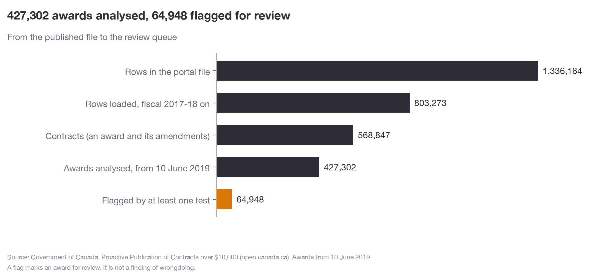

Over the whole period 36.6% of awards are non-competitive. The share rose from 34.2% in fiscal 2019-20 (from 10 June) to 39.1% in 2024-25, and eased to 37.0% in 2025-26.

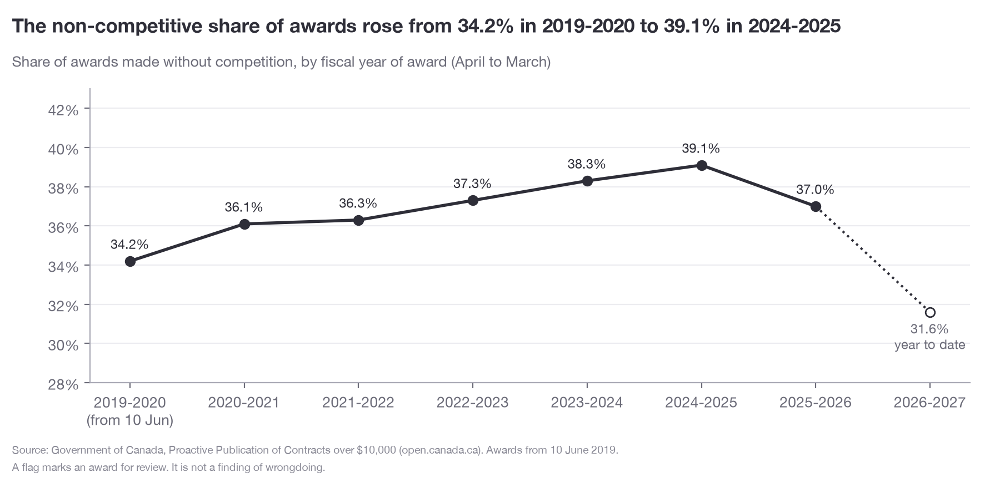

## 2. Cleaning and data quality

Ninety-nine organisations type this data by hand, and it shows. The cleaning script counts everything it changes or drops, so nothing disappears quietly.

| What the cleaning did | Rows |
|---|---|
| Reference numbers written with a non-standard hyphen, replaced | 331 |
| Dropped: contract date before April 2017 (outside the loaded period) | 532,899 |
| Dropped: no total contract value | 10 |
| Dropped: contract date in the future | 2 |
| Reporting period not in the standard form, set to blank | 2,128 |
| Rows kept | 803,273 |

The 331 reference numbers are worth a sentence. They contain a character that looks exactly like a hyphen on screen and is a different character underneath, so an amendment written that way would never match its award. I noticed it while reading one contract's long chain of amendments, where two reference numbers were typed with a different hyphen from the rest.

After loading, 18 checks have to pass or the whole database rebuild is rolled back: keys are unique, every contract has an award row behind it, every flag points at a real award, and so on. All 18 pass. A further 16 checks do not block anything. They describe how departments report, and a reader should know them before trusting any test. These counts cover all 803,273 loaded rows, from April 2017.

| What the data looks like | Count |
|---|---|
| Award rows with no number of bids | 321,707 |
| Non-competitive award rows with no s.6 exception recorded | 122,222 |
| Amendments whose award is outside the loaded period | 43,235 |
| Award rows where total differs from original plus amendment by over $1 | 16,759 |
| Rows where the delivery date is before the contract date | 5,332 |
| Contracts whose rows disagree on how the contract was procured | 4,217 |
| Procurement numbers reported as a new award more than once | 2,183 |
| Award rows under $10,000 in a file of contracts over $10,000 | 1,944 |
| Award rows with no solicitation procedure | 422 |
| Award rows with no commodity type, so no limit can be applied | 94 |

Two of these deserve a closer look.

The s.6 exception is the reason a department gives for not soliciting bids. The [data dictionary](https://open.canada.ca/data/recombinant-published-schema/contracts.json) marks the field as optional, and the early years show it: inside the analysis window it is blank for 98.3% of non-competitive awards in fiscal 2019-20, falling to 41.7% in 2022-23 and 36.6% in 2025-26. Most of the early blanks give a limited-tendering reason instead (13,205 of 15,513 in 2019-20). So the 122,222 is mostly a field that was not collected, not 122,222 omissions. Since 2022-23 it has stayed between about 37% and 42%.

In 4,217 contracts the award row and the amendment rows give different solicitation procedures. The tests read the award row only. Section 10 shows one case where that matters.

## 3. Vendor names

Every test that groups by supplier depends on recognising the same supplier under different spellings. The loaded rows contain 133,347 distinct spellings. GC Strategies alone appears as "GC STRATEGIES INC", "GCStrategies Inc.", "GCSTRATEGIES INCORPORATED" and, in one department, with that department's own supplier number in front.

I cleaned the names in two passes. The first applies fixed rules: upper case, accents removed, punctuation removed, supplier-number prefixes removed, legal suffixes such as Inc and Ltd removed. A supplier number is only removed when a name follows it, so a Quebec numbered company such as "9107-0003 Québec inc." keeps its whole number. That leaves 94,854 names. The second pass merges names that are identical once spaces are removed (1,392), then names whose letters match at 94 out of 100 or better (5,938), which catches typos. The fuzzy step never merges numbered companies whose numbers differ, and leaves names shorter than six letters alone. That leaves 87,524 vendors.

Fuzzy matching makes mistakes, so I checked it. I drew 100 merged names at random, from both the space and the fuzzy step, and read each against the vendor it was merged into. 95 are the same supplier. The five I rejected include NewAE Technology merged with Neware Technology, which are different firms, and "Luxury Hotels International" merged with "Luxury Hotels International of HK", which may well be a different company. The file with all 100 verdicts is in [`data/processed/vendor_review_sample.csv`](../data/processed/vendor_review_sample.csv). Every merge is recorded in an alias table, so any one of them can be traced and undone.

## 4. The five tests

Each test is a SQL view that returns the awards it flags and a plain sentence saying why.

| Test | What it flags | Awards flagged | Value at award |
|---|---|---|---|
| T1 Contract splitting | Two or more non-competitive awards from one department to one vendor within 30 days, each within the limit, that together exceed it | 13,424 | $289.6M |
| T2 Sole-source near the limit | A non-competitive award in the top 10% of the range that needs no bids ($36,000 to $40,000 for services) | 20,231 | $682.9M |
| T3 Amendment growth | Current value more than 50% above the award, or three or more amendments, for awards of at least $10,000 | 26,659 | $25.1B |
| T4 Possible duplicate | Same department, vendor and value as an earlier contract within 7 days | 9,597 | $1.0B |
| T5 Vendor concentration | A vendor holding more than half of a department's non-competitive spending, in departments with at least $1M of it | 19 | $302.3M |

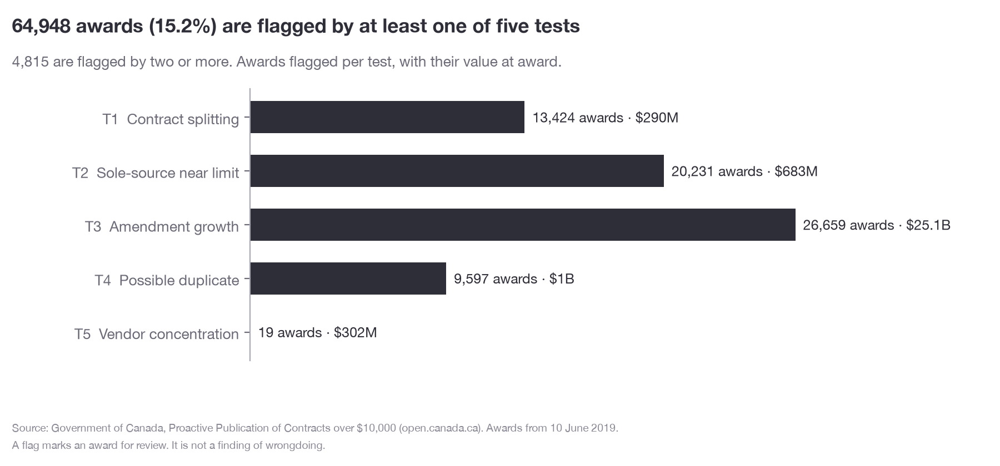

A few choices need explaining.

T1 only looks at non-competitive awards. Splitting matters because it avoids the requirement to solicit bids, and a run of small competed contracts avoids nothing. It also leaves out call-ups against standing offers, where repeated small orders are how the arrangement is meant to work. My first version of T1 looked at all awards and flagged about a third more of them; restricting it to awards where splitting has a motive gives the 13,424 above.

T1 flags every award in the run, including the earlier ones. If three $18,000 awards land within a month, the third one takes the total past $40,000, and all three are flagged.

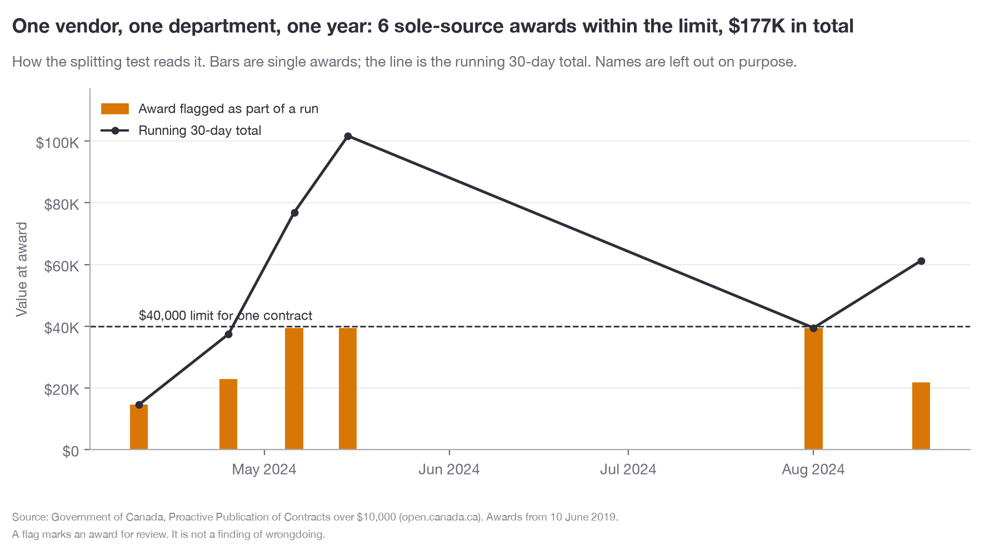

T3 compares the current value with the value at award. For 245 of the awards it flags there is no amendment row at all: the award row itself reports a total more than 50% above its original value.

T5 flags almost nothing. Over seven years it is rare for one supplier to hold most of a department's non-competitive spending. I kept the test because the 19 awards it does flag are large, but it adds little to the queue.

## 5. Awards just under the limit

If contracts are sized or priced to stay within the limit, there should be more awards just under it than the surrounding values suggest. I measured that directly.

I counted awards in $1,000 steps of contract value. For services, I fitted a trend to the ten steps from $25,000 to $35,000, extended it over the five steps from $35,000 to $40,000, and compared it with the awards actually there. I only used values up to the limit. Above it the rules change and the count drops for legal reasons, so those values say nothing about what the count below "should" be.

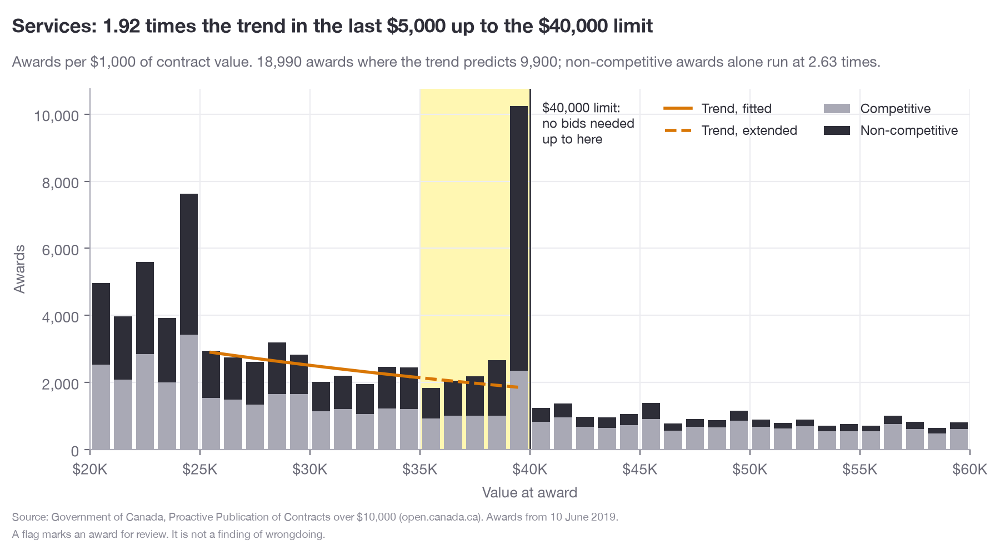

There are 18,990 service awards in the last $5,000 up to the limit. The trend predicts 9,900. That is 1.92 times as many, with a 95% interval of 1.84 to 1.99.

Almost all of the excess sits in the final step. The $1,000 ending at $40,000 holds 10,245 awards. The four steps before it hold about 2,186 each. 880 awards are for exactly $40,000.

That alone does not show contracts are being shaped around the limit, because people like round numbers. Two comparisons address that.

The first is who gets these contracts. The limit only exempts non-competitive awards from soliciting bids, so competed contracts have less reason to stay under it. For them the figure is 1.25 times the trend. For non-competitive awards it is 2.63 times. In the last $5,000 under the limit, 66.8% of service awards are non-competitive. In the $5,000 above it, 31.7% are.

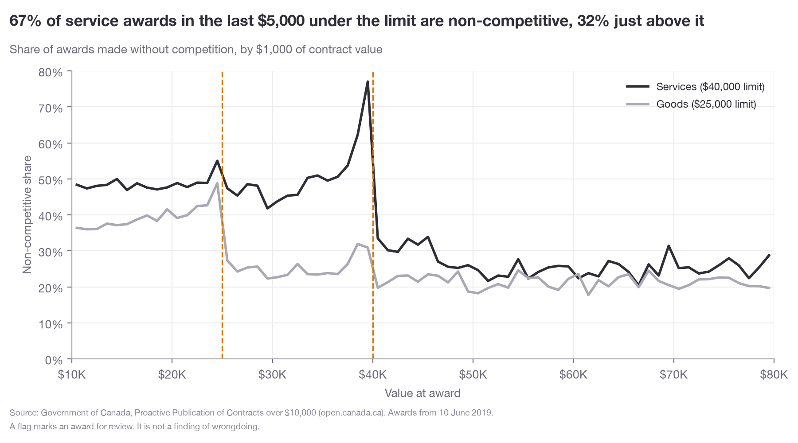

The second is a placebo. I ran the identical calculation at $60,000, $70,000, $80,000 and $90,000. These are round numbers like $40,000, and no procurement rule changes at any of them. For all service awards the four results run from 0.89 to 1.21 times the trend. That range is what round-number pricing and ordinary noise produce with this method, and it is wider than the 95% interval above. The 1.25 for competitive awards at the real limit sits just above it. The 2.63 for non-competitive awards is far outside.

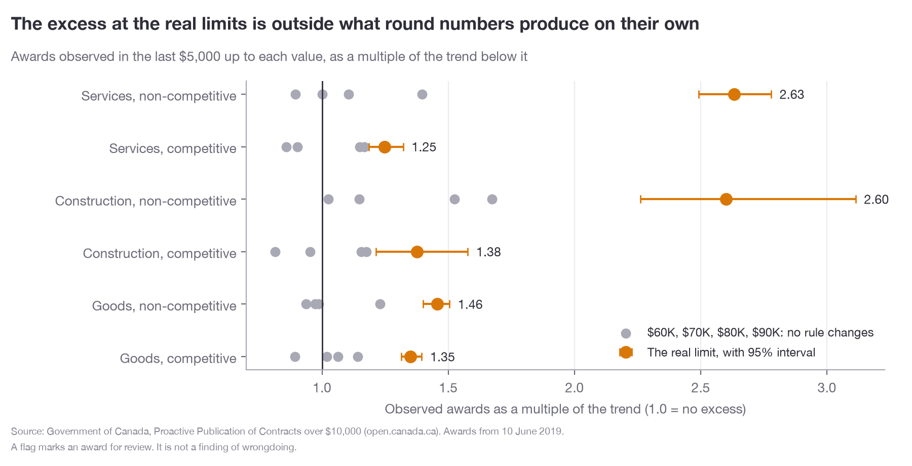

I should say how I arrived at four placebo values. I began with one per commodity type, and for goods I chose $45,000. It came out well below 1, because its trend was fitted on $30,000 to $40,000, which overlaps the $40,000 limit. I replaced it with four values high enough to be clear of both limits. Using four also showed me something a single placebo had hidden: the method's own results wander by about 20% either side of 1.

Construction contracts, which share the $40,000 limit, look like services: 1.85 times overall and 2.60 times for non-competitive awards, on far fewer contracts.

Goods are different, and I do not think the same story applies. The excess under the $25,000 limit is 1.40 times the trend, clearly above the placebo range of 0.91 to 1.16. But competitive goods awards show almost the same excess as non-competitive ones (1.35 against 1.46). Whatever holds goods contracts under $25,000 acts on competed contracts too, so the bid requirement cannot be the whole explanation. Another rule at the same dollar value, such as a department's own purchasing authority for goods, would produce this pattern. The data cannot tell me which.

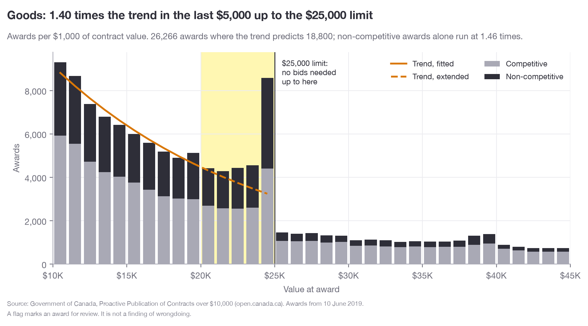

Department by department, 27 departments have enough service awards near the limit (at least 300) to estimate on their own. A single department has far fewer awards, so its placebos wander much further from 1 than the government-wide ones, and I compared each department with its own four placebos. In 19 of the 27 the estimate sits above the department's own placebo range, and in 13 the whole 95% interval does.

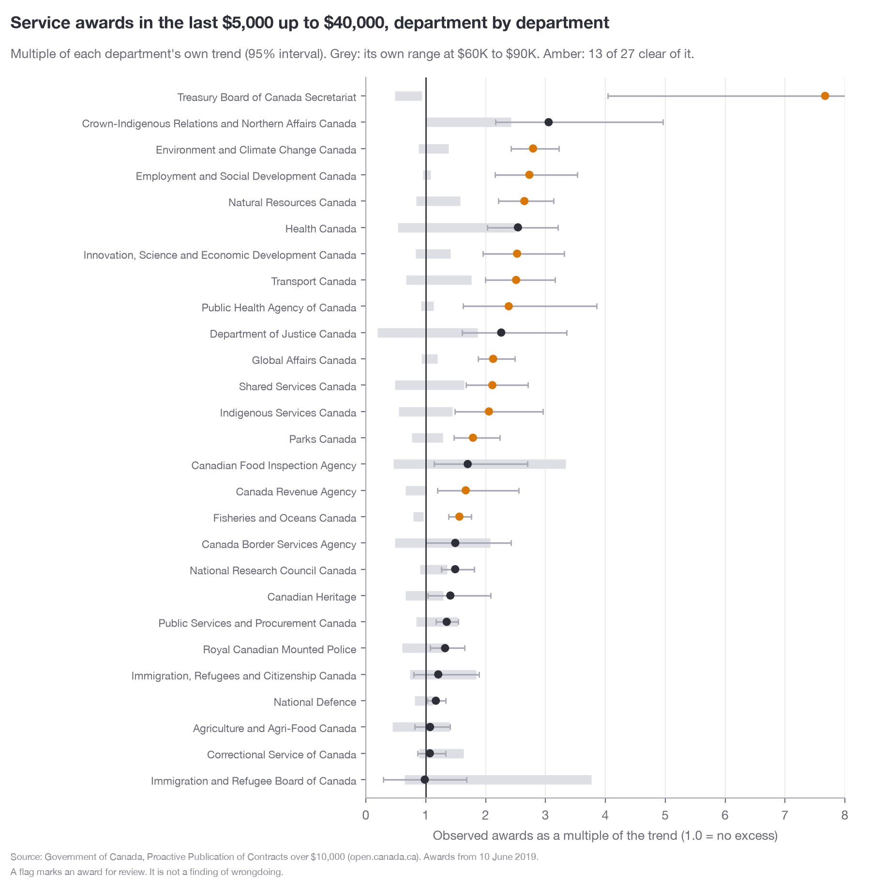

## 6. Amendments

A contract can start small and grow. 54,351 of the awards analysed have at least one amendment, and T3 flags 26,659 that grew by more than half or were amended three times or more.

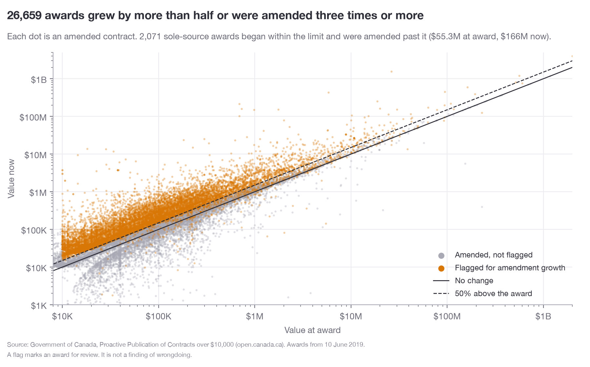

Many of these are unremarkable. Departments are told to report option years as amendments when they are exercised, so a contract with two option years will show as growing even when everything was priced at the start.

One group is harder to explain that way. 119,426 awards were made without competition at a positive value within the limit. 2,071 of them have at least one amendment and are now above the limit. Together they were worth $55.3 million at award and are worth $165.7 million now, and 576 are now more than double the limit. Not all of them were sole-sourced because of their size: 468 record the dollar limit as the reason for not competing, the rest give another reason or none, and 430 are call-ups against standing offers. For the 468, the reason given at award no longer fits the contract.

The ten highest-ranked awards in the review queue are all of this kind.

## 7. How much the cut-offs matter

Each test has a number in it that is a judgement call. I moved each one and counted again.

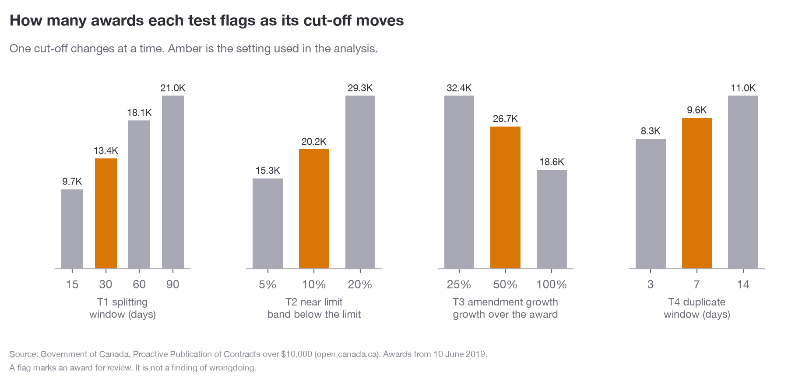

| Test | Cut-off | Awards flagged |
|---|---|---|
| T1 window | 15, **30**, 60, 90 days | 9,675 · **13,424** · 18,050 · 21,049 |
| T2 band below the limit | 5%, **10%**, 20% | 15,327 · **20,231** · 29,320 |
| T3 growth over the award | 25%, **50%**, 100% | 32,417 · **26,659** · 18,584 |
| T4 window | 3, **7**, 14 days | 8,264 · **9,597** · 10,993 |

T4 barely moves, which says duplicates are mostly same-day or next-day pairs. T1 is the most sensitive: tripling the window from 30 to 90 days raises its count from 13,424 to 21,049. The 30-day window is a convention, and a reviewer with more time could reasonably widen it. None of the counts changes character at a different setting, which is the thing I wanted to rule out.

## 8. The review queue

A reviewer needs an order to work in. Each award gets a score from 0 to 100:

score = flag points × (0.5 + 0.5 × size)

Flag points add the weights of the tests that flagged the award: 30 for splitting, 25 for amendment growth, 20 for near the limit, 15 for a possible duplicate, 10 for concentration. Size is the award's rank by value among all awards, from 0 for the smallest to 1 for the largest. The same flags therefore count twice as much on the largest contract as on the smallest.

| Rank | Department | Type | At award | Now | Amendments | Tests | Score |
|---|---|---|---|---|---|---|---|
| 1 | Employment and Social Development Canada | Service | $39,900 | $80,601 | 2 | 4 | 74.0 |
| 2 | National Research Council Canada | Good | $22,600 | $34,967 | 1 | 4 | 63.8 |
| 3 | Fisheries and Oceans Canada | Construction | $39,997 | $79,994 | 1 | 3 | 61.9 |
| 4 | Natural Resources Canada | Service | $39,996 | $146,900 | 2 | 3 | 61.9 |
| 5 | Fisheries and Oceans Canada | Construction | $39,900 | $74,550 | 1 | 3 | 61.7 |
| 6 | Employment and Social Development Canada | Service | $39,900 | $68,250 | 1 | 3 | 61.7 |
| 7 | Employment and Social Development Canada | Service | $39,900 | $130,973 | 2 | 3 | 61.7 |
| 8 | National Research Council Canada | Service | $39,900 | $74,307 | 1 | 3 | 61.7 |
| 9 | Parks Canada | Service | $39,900 | $60,354 | 1 | 3 | 61.7 |
| 10 | Innovation, Science and Economic Development Canada | Service | $39,889 | $107,689 | 1 | 3 | 61.6 |

Vendor names are left out of this table on purpose. They are public, and they are in the database for the person doing the review. A ranked list of named suppliers in a report invites a reading the data does not support.

The top of the queue is a consistent picture: sole-sourced just under the limit, part of a run of awards to the same vendor, then amended well past it.

The score has a weakness. It rewards the number of flags more than the dollars involved. A contract that went from $4.4 million to $11.1 million through three amendments carries one flag and ranks 5,249th. A reviewer who cares about dollars first should sort the flagged awards by value instead.

## 9. Checking the work

I wrote the five tests twice: once in SQL, and once in pandas from the same written definitions, without copying the logic across. A script then compares the two award by award.

For each test it checks the number of awards flagged, their total value, and that no award is flagged by one version and not the other. It also checks that the risk scores match and that both versions produce the same top 100. That is 17 checks and all 17 match.

Getting there took some care, because SQL and pandas disagree by default on details the definitions had left open. A SQL range window counts every award dated the same day, and a pandas rolling window does not, so the pandas version adds up each day first. When two identical contracts share a date, each side has to pick the same one as "the earlier", so both sort by contract key in the same byte order.

Writing a test twice catches a coding mistake in one version. It cannot catch a mistake both versions share: my reading of the rules, or the SQL that builds the contracts both versions read. Going back over the finished project against the regulation's wording and the raw rows, I found several of those. The numbers in this report are after the fixes.

- I had written "within the limit" as strictly less than $40,000. The regulation says "does not exceed", so an award of exactly $40,000 is within it; 767 non-competitive awards sit at exactly their limit.
- My first analysis window started in April 2019, two months before the $40,000 limit existed, which put 12,315 awards against a rule that did not yet apply to them.
- The current value of a contract could come from a second award row filed under the same procurement number, and a $0 award row counted as "within the limit". The amended-past-limit figure in section 6 had been $277 million on that basis. The contract-building SQL now has its own tests on hand-made rows.
- A supplier-number rule chopped Quebec numbered companies, so "9081-0060" and "9180-0060" became one vendor.
- Each department was compared with the government-wide placebo range, which flattered small departments.
- The first version of section 10 compared the ArriveCAN contractors with all of CBSA's other awards, most of which are much smaller.

## 10. Would the tests have pointed at ArriveCAN?

The data has no column saying which contracts turned out to be a problem, so the tests cannot be scored the usual way. The nearest thing is to take contracts that an auditor later examined in detail and see what the tests make of them.

In February 2024 the Auditor General tabled [Report 1, ArriveCAN](https://www.oag-bvg.gc.ca/internet/English/att__e_44429.html) (also on the [open data portal as a PDF](https://open.canada.ca/data/en/info/2a492f50-15c0-4ced-91b9-3260e85e1f7a)), on the border app built during the pandemic. Her office estimated the app's cost at about $59.5 million. Exhibit 1.1 attributes the largest share, $19.1 million, to GC Strategies, and $7.9 million to Dalian Enterprises (tied with Amazon Web Services for second). Paragraph 1.38 says the first ArriveCAN contract went to GC Strategies through a non-competitive process in April 2020, initially valued at $2.35 million.

I took every Canada Border Services Agency award from April 2020 to March 2023 to GC Strategies, to Dalian Enterprises, and to Coradix, Dalian's partner in a joint venture, alone or together. The agency's [briefing to the Public Accounts committee](https://www.cbsa-asfc.gc.ca/transparency-transparence/pd-dp/bbp-rpp/pacp/2024-05-14/overview-apercu-eng.html) lists GC Strategies, Coradix and the Dalian/Coradix joint venture together. The public data does not say which contracts were for ArriveCAN, so this group is wider than the app. It is 158 awards, all of them services.

The broad comparison first.

| | Case awards | CBSA's other awards | All other awards |
|---|---|---|---|
| Awards | 158 | 4,959 | 427,144 |
| Flagged by any test | 36.08% | 17.18% | 15.19% |
| Amendment growth (T3) | 23.42% | 8.17% | 6.23% |
| Possible duplicate (T4) | 13.92% | 6.33% | 2.24% |
| Contract splitting (T1) | 0.00% | 0.71% | 3.14% |
| Near the limit (T2) | 0.63% | 2.50% | 4.74% |
| In the top 10% of the queue | 23.42% | 8.81% | 10.01% |

That looks like the tests picking these contracts out. Most of it is size. The case awards are large service contracts, and CBSA's other awards are mostly small ones; amendments and duplicates are both more common on large contracts. Comparing like with like, CBSA's service awards of $100,000 or more over the same three years:

| | Case awards, services of $100,000+ | CBSA's other services of $100,000+, same period |
|---|---|---|
| Awards | 133 | 412 |
| Flagged by any test | 33.83% | 35.44% |
| Amendment growth (T3) | 18.80% | 33.01% |
| Possible duplicate (T4) | 16.54% | 4.13% |
| In the top 10% of the queue | 18.80% | 33.01% |

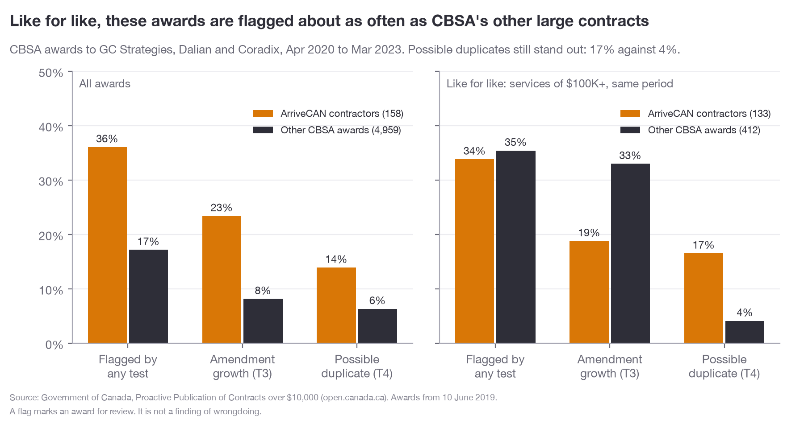

Like for like, the tests flag these contracts about as often as the agency's other large service contracts, and they grew through amendments less often, not more. One pattern still sets them apart: identical-value contracts issued within a week of each other, four times as often. Splitting and near-the-limit pricing flag none of the large ones; those two tests are built around the $40,000 limit and have nothing to say about a $2 million award.

The first contract the audit names is in the data: a $2,350,000 award from CBSA to GC Strategies dated 8 April 2020. It has four amendments and is now worth $13,936,800, so T3 flags it, and it ranks 5,667th of 427,302 awards, in the top 1.3%. Its rows in the published data do not agree with each other. The award row and the first two amendments code it as competitive open bidding. The two amendments filed in the last quarter of fiscal 2021-22 code it as non-competitive, with limited-tendering reason 81, extreme urgency, which matches the audit's account. The tests read the award row only, so they treat this contract as competitive.

So the honest result is narrow. Measured against comparable contracts, these tests would not have singled out the ArriveCAN contractors by their overall flag rate. They would have shown an unusual share of identical contracts issued in batches. This is a single case, the group includes work unrelated to ArriveCAN, and a flag on these contracts shows nothing the audit did not already establish.

## 11. What I would do with this

Three controls follow from the results.

Check cumulative awards before approving a sole-source contract. A system that shows the approver what the same vendor has received from the same department in the past 30 days would surface the runs T1 finds, at the moment they can still be questioned.

Re-test the exemption when a contract is amended. 468 contracts were sole-sourced under the dollar limit and then amended past it. An amendment that takes such a contract past the limit could require the same justification a contract of that size would have needed at the start.

Make the reason for not competing a required field, and check that a contract's rows agree. The publication standard lists the s.6 exception as optional, and since 2022-23 between about 37% and 42% of non-competitive awards leave it blank each year. In 4,217 contracts the award and amendment rows disagree on how the contract was procured.

## 12. Limits of this analysis

The data is what departments typed. A contract reported with the wrong procurement number will not find its amendments, a vendor spelt two ways that my matching missed will count as two, and the tests take the solicitation procedure from the award row, which in 4,217 contracts disagrees with a later row.

Departments do not record the order of filings within a quarter. When two amendments to one contract share the latest quarter, I take the higher total as the current value.

Contracts of $10,000 or less are not in the file, so a contract split into pieces that small is invisible here.

The limits are $25,000 for goods and $40,000 for other contracts, as section 6(b) has read since 10 June 2019. The regulation allows $100,000 for architectural and engineering services tied to construction and for international development work. The data cannot identify those contracts, so they are tested against $40,000, which is stricter than the rule for that group.

Recent contracts have had less time to be amended. Fiscal 2026-27 is seven months old in this data, and its amendment counts will rise.

The cut-offs are conventions and the weights in the risk score are my judgement. Section 7 shows how the counts move. The changes I made after seeing results are listed in section 9.

The vendor review was done by one person reading 100 names. It supports "about 95% of merges are right". It says nothing about pairs the matching failed to merge.

## 13. Reproducing this

Everything is rebuilt by one script from the published file: `./run_pipeline.sh`. It downloads the data, cleans it, builds the database and its checks in a single transaction, reconciles SQL against pandas, runs the bunching, sensitivity and case-study scripts, redraws the charts and runs the unit tests. Every number in this report is in [`data/processed/results.json`](../data/processed/results.json), written by that run.

## Sources

- Government of Canada, [Proactive Publication: Contracts over $10,000](https://open.canada.ca/data/en/dataset/d8f85d91-7dec-4fd1-8055-483b77225d8b) (open.canada.ca), and its [data dictionary](https://open.canada.ca/data/recombinant-published-schema/contracts.json). Contains information licensed under the [Open Government Licence, Canada](https://open.canada.ca/en/open-government-licence-canada).
- [Government Contracts Regulations, SOR/87-402, section 6](https://laws-lois.justice.gc.ca/eng/regulations/SOR-87-402/section-6.html), as in force since 10 June 2019; and [the earlier wording](https://laws-lois.justice.gc.ca/eng/regulations/SOR-87-402/section-6-20060322.html), unchanged from 1996 until then.
- Office of the Auditor General of Canada, [2024 Report 1: ArriveCAN](https://www.oag-bvg.gc.ca/internet/English/att__e_44429.html), tabled 12 February 2024: Exhibit 1.1 and paragraph 1.38. [PDF on open.canada.ca](https://open.canada.ca/data/en/info/2a492f50-15c0-4ced-91b9-3260e85e1f7a).
- Canada Border Services Agency, [Overview: Standing Committee on Public Accounts, Report 1, ArriveCAN](https://www.cbsa-asfc.gc.ca/transparency-transparence/pd-dp/bbp-rpp/pacp/2024-05-14/overview-apercu-eng.html), 14 May 2024.
