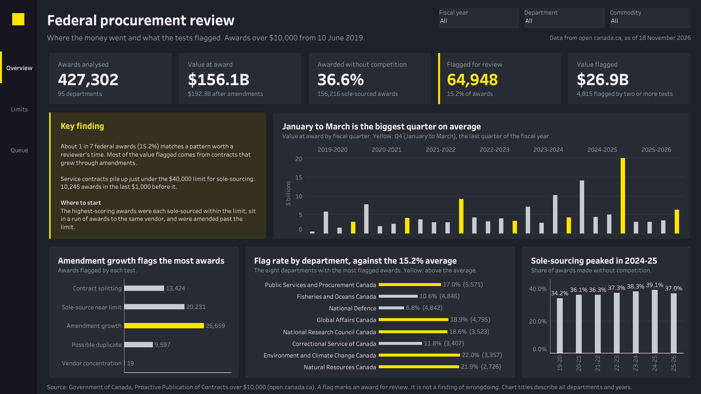

# Tableau dashboard

`procurement_review.twb` is a three-page dashboard on the same run as the report: an overview, the pile-up under the $40,000 limit, and the review queue. `build_workbook.py` writes it, and `./run_pipeline.sh` runs that script after the data files, so the figures in its text (key findings, chart titles, the data date) always come from `data/processed/results.json`.

## Open it

1. Run `./run_pipeline.sh` once. The workbook reads the files in `data/tableau/`, and the largest of them, `awards.csv` (77 MB), is rebuilt by the run rather than kept in the repository.
2. Open `tableau/procurement_review.twb` in Tableau Desktop or Tableau Public. The data path is relative to the workbook, so it opens wherever the repository is.
3. For the full-screen view, choose Window > Presentation Mode. Switch pages with the tabs at the bottom.

To publish, use File > Save to Tableau Public. Tableau makes an extract of the data on the way, and the page carries your name, so the dashboard has no author line of its own. Put a link to this repository in the description.

## The pages

| Page | Shows | Filters and clicks |
|---|---|---|
| [Overview](screenshots/1_overview.png) | Awards, value, sole-sourced share and flags; value by quarter; flags by test; flag rate by department; sole-sourced share by year | Fiscal year, department, commodity |
| [Limits](screenshots/2_limits.png) | Awards per $1,000 against the trend; sole-sourced share by value; each department's excess against its own round-number range | Commodity: services, goods or construction |
| [Queue](screenshots/3_queue.png) | The 13 highest-scoring flagged awards and why each is flagged | Department, commodity; click a row to show its reasons |

Vendor names are not in the dashboard files. Each vendor has a code (`V00042`), so a reader can still see that several awards went to the same supplier.

A filter changes the charts, not their titles: the titles describe all departments and years, and the footer says so.

## How it is built

A `.twb` file is XML, and `build_workbook.py` writes it directly. A few choices that are not obvious from Tableau's menus:

- Two-colour charts (the yellow quarter, departments above the average) use two measures on Measure Values, because Tableau applies colour palettes to Measure Names reliably and not always to calculated fields.
- The queue, the department ranking and the top ten on the Limits page use context filters, so "top 13" means the top 13 of what the filters leave.
- "Why it is flagged" shows the first award down the rank, so it is never empty, and a click on a row replaces it.
- Null values are hidden and their badge is off, which is what Analysis > Special Values > Hide does.

Colours: page `#1F1F27`, panels `#2A2A33`, rail `#16161C`, text `#F2F2F5` and `#A3A3B0`, marks `#C9C9D2`, gridlines `#3A3A46`, highlight `#FFE600`.
